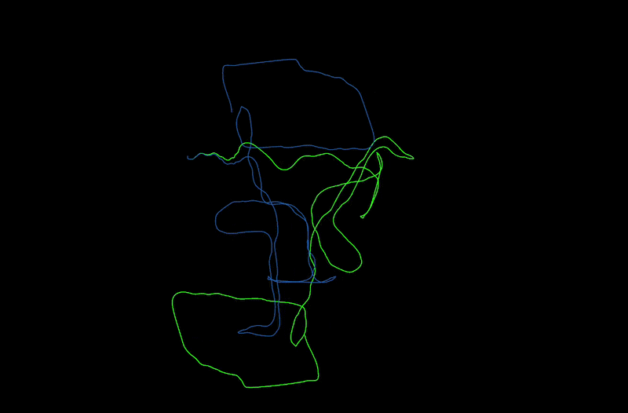

# slemslam

A ROS 2 package for real-time 3D Semantic SLAM using YOLOv8, ONNX Runtime, and GTSAM (iSAM2) factor graph optimization.

---

## Demos

| Office Sequence | Subway Station Sequence |
| :---: | :---: |
|  |  |
| *Continuous indoor loop closures* | *Global map snap after extended loop* |

* **Blue**: Ground Truth
* **Green**: GTSAM Semantic SLAM

---

## How It Works

1. **Perception**: Runs YOLOv8 ONNX inference on RGB-D images to detect 3D centroids of objects (`chair`, `bench`, `couch`, `tv`, etc.).
2. **Keyframe Graph**: Adds robot poses to GTSAM only when moving spatially ($\Delta d > 0.25\,\text{m}$ or $\Delta \theta > 0.10\,\text{rad}$).
3. **Data Association**: Matches new detections to existing landmarks if they are the same category and within $2.5\,\text{m}$.
4. **Loop Closures**: Uses GTSAM iSAM2 with Huber loss to correct trajectory drift when landmarks are re-observed.

---

## Benchmark Results

Evaluated on the MIT SPARK uHumans2 dataset using Absolute Trajectory Error (ATE RMSE):

| Dataset | Raw Odometry RMSE | SLAM RMSE | Error Reduction |
| :--- | :---: | :---: | :---: |
| **`office`** | 23.02m | **1.68m** | **92.7%** |
| **`subway`** | 59.31m | **15.82m** | **73.3%** |

---

## Quickstart

### Build
```bash
cd ~/colcon_workspaces/slemslam_ws
colcon build --packages-select slemslam
source install/setup.bash
```

### Run
1. Start the SLAM system:
   ```bash
   ros2 launch slemslam slam_compare.launch.py
   ```
2. Play your bag:
   ```bash
   ros2 bag play <path_to_bag>
   ```
